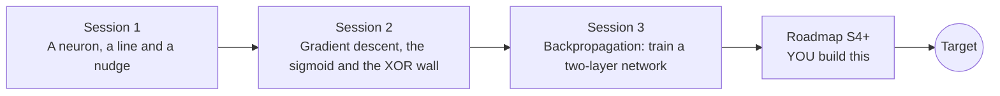

# openneuralnet

[](https://github.com/KrunalPanchal1995/openneuralnet/actions/workflows/ci.yml)   [](https://colab.research.google.com/github/KrunalPanchal1995/openneuralnet/blob/main/sessions/session-01/lesson.ipynb) [](https://krunalpanchal1995.github.io/openneuralnet/)

**Train a neural network from scratch and watch backpropagation, in three sessions.**

openneuralnet teaches how a network learns, from one neuron and a line, to a two-layer network with hand-coded backpropagation that you check against finite differences, using only Python and a browser.

- **Start from one neuron.** Session 1 needs only school algebra: a weighted sum and a line.
- **Write backpropagation yourself.** Session 3 derives and codes the gradients of a two-layer network in plain numpy, no framework.
- **Know the gradients are right.** A finite-difference gradient check (relative error below 1e-6) is the correctness test, and the checkpoint proves it catches a deliberate bug.
- **Build the missing half.** The repo stops at a two-layer network on purpose; the roadmap shows the path to the Target.

[Target](#the-target) · [Who is this for](#who-is-this-for) · [Quick start](#quick-start) · [Sessions](#sessions) · [Roadmap](#roadmap) · [Contribute](#contribute) · [Explainer PDF](docs/explainer.pdf)

> **This repo is incomplete on purpose.** Sessions 1 to 3 are here and fully working. The finished Target below is a preview of what the community can build next. We show you the path, not the code. Sessions 4 and up are yours.

## The Target

A network with 32 hidden neurons and a two-neuron bottleneck learns two interleaved spiral arms. On the left, the decision boundary starts as a straight cut and bends into a double spiral as the loss falls. In the middle, the loss and accuracy curves show a long plateau and then a sudden drop. On the right, the two hidden numbers of every point start tangled and end as two separate corners that one straight line can split. Your goal over the coming sessions: build that animation yourself.


*Target: a decision boundary morphing as a network learns two spirals, with the loss and accuracy curves and the hidden layer*


*Target: the finished network (boundary, curves, hidden layer)*

Try it live:

- [Math Visual Studio: gradients and optimisation (Atlas S13)](https://krunalpanchal1995.github.io/studio/#atlas?ch=S13&ex=1)

How the Target was made is shown only as a path in [promo/roadmap.md](promo/roadmap.md).

## Who is this for
**higher secondary to advanced undergraduate (levels 4-6).** Topic area: Artificial Intelligence, Data Science and Robotics.

Prerequisites:

- School algebra: lines, slopes and the idea of a derivative (Session 3 uses the chain rule, explained from scratch).
- Python 3.10 or newer; if `python --version` works, you are ready. PRIMER.md explains the rest.
- No prior machine learning, GitHub or linear algebra experience is needed.

New to Python? Read [PRIMER.md](PRIMER.md) first (10 minutes).

## Quick start

No installation knowledge needed. You need [Git](https://git-scm.com/downloads) and [Python 3.10+](https://www.python.org/downloads/) (Windows: tick "Add Python to PATH"). On Mac and Linux type `python3` wherever this page says `python`.

```bash
git clone https://github.com/KrunalPanchal1995/openneuralnet.git
cd openneuralnet
python start.py 1
```

`start.py` creates a private environment, installs what is needed and runs Session 1 with its checkpoint. Next: `python start.py 2`, `python start.py 3`, or `python start.py test` to check everything. Only a checkpoint: `python start.py check 1`.

Four lines show the neuron of Session 1 deciding about a point (they work as they are): Save it as `try.py` and run it with `python start.py run try.py` (this uses the private environment, where NumPy is installed):

```python
import numpy as np
w, b = np.array([1.0, 1.0]), 0.0                # weights and bias of one neuron
x = np.array([2.0, 2.5])                         # one input point
z = w @ x + b                                    # weighted sum
print(z, "fires" if z > 0 else "silent")         # -> 4.5 fires
```

Every session also opens in your browser with sliders (no install): [live apps](https://krunalpanchal1995.github.io/openneuralnet/). Or use the Colab badge above for the notebook.

## Sessions

| # | Session | Model level | Time | Live app |
|---|---|---|---|---|
| 1 | [A neuron, a line and a nudge](sessions/session-01/README.md) | Level 1: conceptual interactive model | 60 min | [open](https://krunalpanchal1995.github.io/openneuralnet/session-01/) |
| 2 | [Gradient descent, the sigmoid and the XOR wall](sessions/session-02/README.md) | Level 2: mathematical engineering model | 75 min | [open](https://krunalpanchal1995.github.io/openneuralnet/session-02/) |
| 3 | [Backpropagation: train a two-layer network](sessions/session-03/README.md) | Level 3: simulation and validation | 90 min | [open](https://krunalpanchal1995.github.io/openneuralnet/session-03/) |

Each session follows the same six steps: A real-world problem, B concept and theory, C visual explanation, D interactive simulation, E worked example and experiment, F assessment and design challenge. Each ends with `checkpoint.py`, which prints `PASS` or `FAIL` against reference numbers. Session 3 also contains the real-world mini-project: **Classify a synthetic two-class data set and report the confusion matrix**.

## Architecture



| Folder or file | What is inside |
|---|---|
| `sessions/` | three sessions: README (A-F), `lesson.py`, notebook, live app, exercises, activity sheet, checkpoint |
| `promo/` | the Target: media, live links, and the roadmap (path only) |
| `docs/` | `explainer.tex` and the built `explainer.pdf` |
| `tests/` | runs every lesson and checkpoint headless |
| `start.py` | one command to set up and run anything |
| `QUALITY.md`, `RUBRIC.md` | the quality checklist and the scoring rubric |
| `.github/` | CI, PDF build, Pages deploy, issue and PR templates |

## Roadmap

| Milestone | What you will build | Difficulty |
|---|---|---|
| Session 4: Softmax and three classes | A network with a softmax output trained on a three-arm spiral data set. | intermediate |
| Session 5: Fight overfitting | The same 100-hidden-neuron network on the 40 noisy points, with a regulariser. | intermediate |
| Session 6: Learn faster | A training loop with a decaying learning rate on the spiral data. | advanced |
| Session 7: Deep and stable | A 20-hidden-layer sigmoid network with batch normalisation. | advanced |
| Session 8: Build the Target animation | A GIF with the decision boundary, the loss and accuracy curves and the hidden-layer view side by side. | advanced |

Full detail with a checkpoint per milestone: [promo/roadmap.md](promo/roadmap.md).

## Contribute
New to GitHub? Read [CONTRIBUTING.md](CONTRIBUTING.md); it starts from zero. Pick an issue labelled `good first issue`. Translations into Hindi, Telugu, Tamil and Malayalam are welcome.

<details>
<summary>Development</summary>

```bash
python start.py test        # runs every lesson and checkpoint
```
Lessons use `# %%` cell markers so they open as notebooks in VS Code. See [QUALITY.md](QUALITY.md) for the standard every session meets.
</details>

## License
MIT. See [LICENSE](LICENSE). Media in `promo/media` is (c) Krunal Panchal, CC BY 4.0.

## Acknowledgments
Part of the [PAN IIT OSS](https://hellofoss.tech-iitb.org/projects) open-source teaching collection, modelled on the structure of [openspline](https://github.com/openspline/openspline). Built on ideas from the Math Visual Studio at https://krunalpanchal1995.github.io/studio/.
