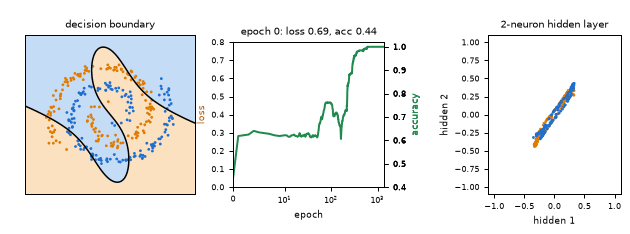
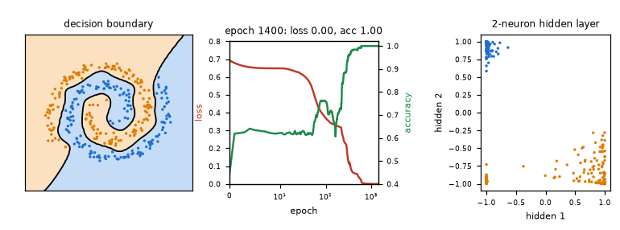

# What you are building toward

A network with 32 hidden neurons and a two-neuron bottleneck learns two interleaved spiral arms. On the left, the decision boundary starts as a straight cut and bends into a double spiral as the loss falls. In the middle, the loss and accuracy curves show a long plateau and then a sudden drop. On the right, the two hidden numbers of every point start tangled and end as two separate corners that one straight line can split. Your goal over the coming sessions: build that animation yourself.

*Target: a decision boundary morphing as a network learns two spirals, with the loss and accuracy curves and the hidden layer*

*Target: the finished network (boundary, curves, hidden layer)*

These results come from a private reference build. The code is not published; the roadmap shows the path so you can build your own.

Live links:

- [Math Visual Studio: gradients and optimisation (Atlas S13)](https://krunalpanchal1995.github.io/studio/#atlas?ch=S13&ex=1)
