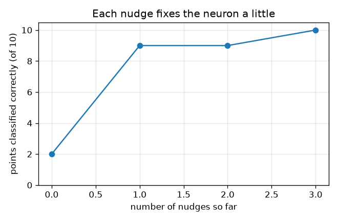
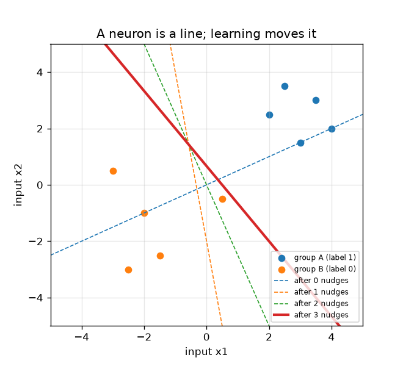

# Session 1: A neuron, a line and a nudge

*Level 1 (conceptual interactive model) · about 60 minutes · openneuralnet*

> This is a simplified educational model. It is not a validated design tool and must not be used for real structures, electrical installations, vehicles, industrial processes or medical decisions.

**Prerequisites**

- School algebra: multiplying, adding and drawing the line y = m x + c.
- You have read PRIMER.md and run `python start.py 1` once.

**Learning objectives.** After this session you can:

- Explain machine learning as finding the settings of a rule from examples instead of typing the rule.
- Compute what one neuron does: a weighted sum of the inputs plus a bias, then fire if it is above zero.
- Show that a neuron draws a straight line between two groups of points.
- Apply the perceptron rule by hand and see the line move until it splits the groups.

## A. Real-world problem
A traditional program is a list of rules a person wrote: if the email contains this word, mark it as spam. Machine learning turns this around: you show the computer many examples with the right answers and it finds the rules itself. The smallest learning machine is a single artificial neuron. Given two numbers about a point (say two measurements of a flower), it must say group A or group B. Can it find, from examples alone, a rule that gets all ten examples right?

## B. Concept and theory
A neuron has inputs x1 and x2, weights w1 and w2 and a bias b. It first computes the weighted sum z = w1 x1 + w2 x2 + b, then fires (output 1) if z > 0 and stays silent (output 0) otherwise. The place where it changes its mind is z = 0, which is a straight line in the (x1, x2) plane; points on one side fire, points on the other side do not. Learning by the perceptron rule: look at one example at a time. If the neuron is right, change nothing. If it is wrong, nudge: add (label - output) times the point to the weights and (label - output) to the bias. A missed group A point (label 1, output 0) adds the point, pulling the line towards it. A wrongly fired group B point (label 0, output 1) subtracts the point, pushing the line away. This is general education about how learning machines work.

| Symbol | Meaning | Unit |
|---|---|---|
| x1, x2 | the two inputs (measurements) of a point | no unit (any consistent unit) |
| w1, w2 | weights: how much each input counts | no unit |
| b | bias: a head start or handicap | no unit |
| z | weighted sum w1 x1 + w2 x2 + b | no unit |
| t | label: the right answer, 1 (group A) or 0 (group B) | no unit |

**Assumptions**

- Only two inputs and two groups, so everything can be drawn.
- The neuron fires when z is strictly above 0; a point exactly on the line does not fire.
- The ten example points are the whole world; there are no mistakes in the labels.

$$ z = w_1 x_1 + w_2 x_2 + b,\qquad \text{output} = \begin{cases}1 & z > 0\\ 0 & z \le 0\end{cases} $$

$$ \text{decision line: } w_1 x_1 + w_2 x_2 + b = 0 \;\Rightarrow\; x_2 = -\frac{w_1 x_1 + b}{w_2} $$

$$ \mathbf w \leftarrow \mathbf w + (t - \text{output})\,\mathbf x,\qquad b \leftarrow b + (t - \text{output}) $$

## C. Visual explanation
The first figure shows the ten points (blue group A, orange group B) and the dividing line after each nudge: the dashed lines are the earlier guesses and the solid line is the final one, which has all ten points on the right side. The second figure counts the points classified correctly after each nudge: 2 at the start, then 9, 9 and 10. Notice that a nudge can leave the count unchanged while still moving the line in the right direction.

*Points classified correctly after each nudge: 2, 9, 9, 10.*

*Ten points and the dividing line after each nudge (dashed: earlier guesses, solid: final).*

## D. Interactive simulation
Run the lesson (`python start.py 1`), then open the live app: [Session 1: one neuron, one line](https://krunalpanchal1995.github.io/openneuralnet/session-01/) (or `app.html` in this folder). Drag the weight and bias sliders and watch the green line move and the ringed (wrong) points change. Switch to the bias view and see how the number of points right changes as only the bias moves.

**Challenge.** Find weights and a bias that classify all 10 points correctly.

## E. Worked example and experiment
**Problem.** Start with w = (1, -2), b = 0 and apply the perceptron rule, visiting the points in the order of the table, until every point is right.

1. Point 1 is (2, 2.5) with label 1. Its sum is z = 1*2 + (-2)*2.5 + 0 = -3, so the neuron is silent: wrong. At the start 2 of the 10 points are right.
2. Nudge 1: output 0, label 1, so w = (1, -2) + (1 - 0)*(2, 2.5) = (3, 0.5) and b = 0 + 1 = 1. Now 9 of 10 are right.
3. Points 2 to 7 are right. Point 8 is (0.5, -0.5) with label 0 but z = 3*0.5 + 0.5*(-0.5) + 1 = 2.25 > 0, so it fires wrongly.
4. Nudge 2: output 1, label 0, so w = (3, 0.5) - (0.5, -0.5) = (2.5, 1) and b = 1 - 1 = 0. Point 8 now has z = 0.75, still wrong; the count stays at 9.
5. In the next pass point 8 gives nudge 3: w = (2.5, 1) - (0.5, -0.5) = (2, 1.5) and b = -1. Now all 10 points are right and nothing more changes.

**Answer.** After 3 nudges the neuron has w = (2, 1.5), b = -1 and classifies 10 of 10 points correctly (2, 9, 9, 10 points right after nudges 0, 1, 2, 3). The dividing line is 2 x1 + 1.5 x2 = 1.

**Experiment.** Draw the ten points on squared paper, cut a straight strip of card and lay it as the dividing line. Slide and turn it until each group is on its own side, and count how many nudges of the strip it takes. A real data set has measurement noise, so no line is perfect and points get misclassified; the model assumes the groups can be split exactly, which real data usually cannot.

## F. Assessment and design challenge
**Question type A: Conceptual.** What is the difference between a traditional program and a machine learning model, and why does the neuron need a bias b in addition to the weights?

Hint

Who writes the numbers? And what happens to the line when b = 0?

Step-by-step solution

In a traditional program a person writes the rules. In machine learning a person writes only the form of the rule (here: weighted sum and threshold) and the numbers in it (weights, bias) are found from labelled examples. Without a bias the line w1 x1 + w2 x2 = 0 always passes through the origin, so it cannot separate two groups that are both on the same side of the origin. The bias slides the line without turning it.

**Question type B: Numerical.** The learned neuron has w = (2, 1.5) and b = -1. What are z and the output for the new point (-0.5, -1.5)? Is that correct if this point is from group B?

Hint

Compute z = w1 x1 + w2 x2 + b and fire only if z > 0.

Step-by-step solution

z = 2*(-0.5) + 1.5*(-1.5) + (-1) = -1 - 2.25 - 1 = -4.25, which is not above 0, so the neuron is silent (output 0): correct for group B. The number has no unit because the inputs are just numbers.

**Question type C: Graph and simulation interpretation.** In the 'points right versus bias' graph with w = (1, 1), over which range of b are all 10 points right, and why does the curve have flat steps?

Hint

For w = (1, 1) the sum z is x1 + x2 + b. Group A sums are at least 4.5 and group B sums are at most 0.

Step-by-step solution

Group A needs x1 + x2 + b > 0 for the smallest group A sum (4.5), so b > -4.5. Group B needs x1 + x2 + b <= 0 for the largest group B sum (0), so b <= 0. All ten are right for -4.5 < b <= 0 (for example b = -2). The curve is a staircase because the count is a whole number that changes only when the line passes over a point.

**Question type D: Design and optimisation challenge.** Design: keep w = (1, 1) and pick a bias that classifies all ten points correctly while staying as far as possible from both groups. Which b, and why?

Hint

The allowed range from question C is -4.5 < b <= 0; the groups are closest to the line at its two ends.

Step-by-step solution

The allowed range is -4.5 < b <= 0, so the middle value b = -2.25 leaves the same room (2.25) on both sides. A line far from both groups is safer when new points arrive with a little noise. Trade-off: with a margin this wide the rule is more robust, but nothing in this data tells us where the true boundary is; any b in the range fits the ten examples equally well. I took b = -2, which also works (checked in the checkpoint).

Score yourself with [RUBRIC.md](../../RUBRIC.md). Print the [activity sheet](activity_sheet.md) to work on paper.

## Common misconceptions
| Common misconception | What is actually true |
|---|---|
| A neuron is a tiny brain that thinks. | In this course a neuron is just a weighted sum followed by a threshold; the intelligence of a network comes from many of them and from the learning rule. |
| Learning means the computer memorises the examples. | The weights are a compact rule (three numbers here). A good rule also works on new points; memorising does not, as Session 3 shows. |
| The line is fixed by the weights alone. | The bias moves the line sideways; the weights set its direction. Both are learned. |
| Each nudge always increases the number of points right. | A nudge fixes the point it looked at, but the count can stay the same or even drop for a moment; the rule still ends in a perfect line for separable data (Session 2). |

## Glossary
- **neuron**: a rule that adds up weighted inputs plus a bias and fires if the total is above zero
- **weight**: a number saying how much one input counts
- **bias**: a number added to the weighted sum that slides the dividing line
- **label**: the right answer for an example, 0 or 1
- **perceptron rule**: if the neuron is wrong, add (label - output) times the point to the weights
- **machine learning**: finding the numbers of a rule from labelled examples

## Finish
1. Do the three coding tasks in [exercises.md](exercises.md).
2. Run `python start.py 1` again after your changes. It ends with the checkpoint; when it prints `PASS`, you are done. (Checkpoint only: `python start.py check 1`.)

Next: [Session 2](../session-02/README.md)
