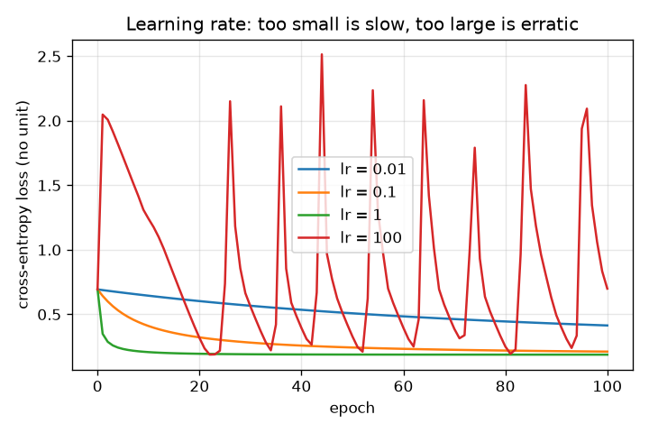
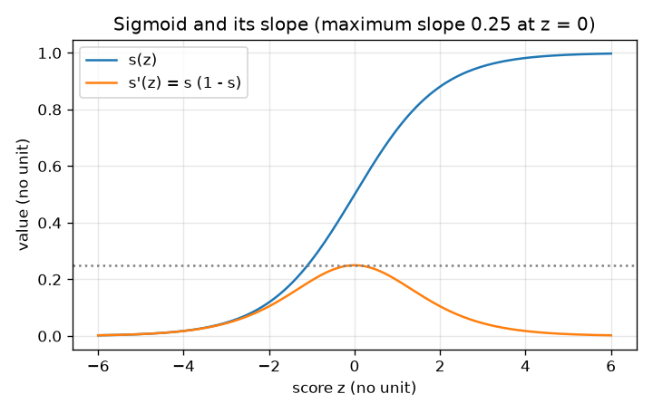
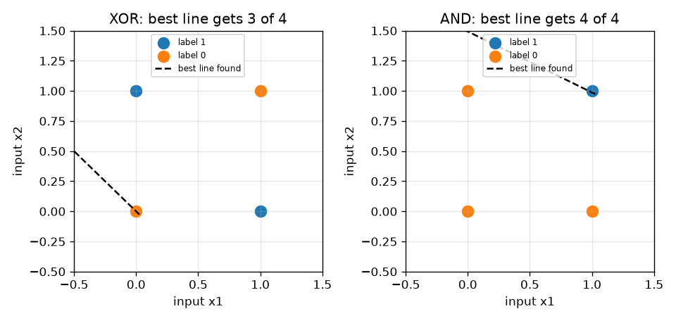

# Session 2: Gradient descent, the sigmoid and the XOR wall

*Level 2 (mathematical engineering model) · about 75 minutes · openneuralnet*

> This is a simplified educational model. It is not a validated design tool and must not be used for real structures, electrical installations, vehicles, industrial processes or medical decisions.

**Prerequisites**

- Session 1: the neuron and the perceptron rule.
- The idea of a slope (derivative); the chain rule is not needed yet.

**Learning objectives.** After this session you can:

- Explain why the perceptron rule stops after a finite number of updates on separable data, and verify it on seeded data.
- Use the sigmoid and its derivative s' = s (1 - s), and check the derivative numerically.
- Train logistic regression by gradient descent with the cross-entropy loss and check the gradient (p - y) x against finite differences.
- Show the effect of the learning rate (too small is slow, too large diverges) and prove by exhaustive search that no single line solves XOR.

## A. Real-world problem
A spam filter should not only say yes or no; it should say how sure it is, for example 'this message is 90 percent likely to be spam', and it should learn its settings by a rule we can check. How do we turn a score into a probability, how do we measure how wrong the probabilities are, and how do we change the weights to be less wrong? And is there a pattern, as simple as 'exactly one of two switches is on', that a single neuron can never learn? This is general education about learning algorithms, not a tool for real decisions.

## B. Concept and theory
Part 1: the perceptron convergence theorem. Add a constant 1 to every input and put the bias into the weights. If some line separates the data with margin gamma (smallest distance of any point to it, for unit-length weights) and all inputs have length at most R, the perceptron rule started from zero makes at most (R / gamma)^2 updates and then stops. Part 2: the sigmoid s(z) = 1 / (1 + e^(-z)) squeezes a score into (0, 1); its derivative is s' = s (1 - s), at most 0.25. Part 3: logistic regression models the probability of label 1 as p = s(w.x + b) and measures the error by the cross-entropy loss L = -mean(y ln p + (1 - y) ln(1 - p)). Its gradient is wonderfully simple: dL/dw = mean((p - y) x) and dL/db = mean(p - y). Gradient descent repeats w = w - lr * dL/dw, where lr is the learning rate. Part 4: the learning rate. On the one-weight loss L = w^2, a step gives w = (1 - 2 lr) w, which shrinks only if lr < 1. Part 5: XOR. The labels are 0 for (0,0) and (1,1), and 1 for (0,1) and (1,0). For any line the sums z satisfy z(0,0) + z(1,1) = z(0,1) + z(1,0) (because the weighted sum is linear); if both label-1 points fire, the right side is above 0, so z(0,0) and z(1,1) cannot both be at most 0, and one label-0 point fires wrongly. So no line gets all four right.

| Symbol | Meaning | Unit |
|---|---|---|
| t | label in the perceptron rule, +1 or -1 | no unit |
| R, gamma | largest input length and margin of the data | same unit as the inputs |
| z | score w.x + b | no unit |
| s(z) | sigmoid of the score, read as a probability | no unit |
| p, y | predicted probability of label 1, and the true label (0 or 1) | no unit |
| L | cross-entropy loss, averaged over the examples | no unit |
| lr | learning rate (step size) | no unit |

**Assumptions**

- For the convergence theorem the data are exactly separable by a line.
- Logistic regression here uses all examples for every step (full-batch gradient descent), starting from zero weights.
- The 1D example L = w^2 is a model of the idea of a step that is too long; real losses are not that simple.

$$ \text{updates} \le \left(\frac{R}{\gamma}\right)^2 $$

$$ s(z)=\frac{1}{1+e^{-z}},\qquad s'(z)=s(z)\,\bigl(1-s(z)\bigr) $$

$$ L=-\frac1N\sum_i\bigl[y_i\ln p_i+(1-y_i)\ln(1-p_i)\bigr],\quad p_i=s(\mathbf w\cdot\mathbf x_i+b) $$

$$ \frac{\partial L}{\partial \mathbf w}=\frac1N\sum_i (p_i-y_i)\,\mathbf x_i,\qquad \frac{\partial L}{\partial b}=\frac1N\sum_i (p_i-y_i) $$

$$ \mathbf w \leftarrow \mathbf w-\text{lr}\,\frac{\partial L}{\partial \mathbf w},\qquad w_{k+1}=(1-2\,\text{lr})\,w_k \;\text{ for } L=w^2 $$

## C. Visual explanation
The first figure plots the sigmoid and its slope: the slope is largest (0.25) at z = 0 and falls towards 0 on both sides. The second figure shows the loss against epoch for four learning rates on the same overlapping data: 0.01 is a slow slope, 1 drops quickly to about 0.19, and 100 jumps around and ends at 0.70, no better than the start. The third figure shows the best straight line for XOR (3 of 4 points right) next to AND, where a line gets all 4: the same search that finds 6723 perfect lines for AND finds none for XOR.

*Loss against epoch for four learning rates: too small is slow, too large is erratic.*

*Sigmoid and its slope: the maximum slope is 0.25 at z = 0.*

*The best line found by exhaustive search: 3 of 4 points for XOR, 4 of 4 for AND.*

## D. Interactive simulation
Run the lesson (`python start.py 2`), then open the live app: [Session 2: gradient descent on 12 points](https://krunalpanchal1995.github.io/openneuralnet/session-02/) (or `app.html` in this folder). Choose a learning rate and a number of epochs and watch the green line and the loss curve for the small 12-point data set. Compare lr = 0.05, 1 and 20.

**Challenge.** Get the loss down to 0.36 or less in at most 12 epochs.

## E. Worked example and experiment
**Problem.** One example: input x = (2, -1) with label 0. Start with w = (0, 0), b = 0. Do one gradient descent step with learning rate 0.4 and check the loss falls.

1. Score z = 0, so p = s(0) = 0.5 and the loss is -ln(1 - 0.5) = 0.6931.
2. Gradient: (p - y) x = 0.5 * (2, -1) = (1, -0.5) and (p - y) = 0.5 for the bias.
3. Step: w = (0, 0) - 0.4 * (1, -0.5) = (-0.4, 0.2) and b = 0 - 0.4 * 0.5 = -0.2.
4. New score z = (-0.4)*2 + 0.2*(-1) + (-0.2) = -1.2, so p = s(-1.2) = 0.2315.
5. New loss = -ln(1 - 0.2315) = 0.2633. The loss fell from 0.6931 to 0.2633, and the probability of label 1 fell from 0.5 to 0.23, as wanted.

**Answer.** After one step w = (-0.4, 0.2), b = -0.2, p = 0.2315 and the loss falls from 0.6931 to 0.2633.

**Experiment.** Take a coin-flip style experiment: 100 people each rate 'is it spam?' for 12 short messages, and you fit logistic regression to their votes. The model gives a smooth probability, but real people disagree for reasons the two numbers x1 and x2 cannot capture; the fitted probability is only as good as the inputs. The model also assumes the log-odds are a straight function of the inputs, which real data often violates.

## F. Assessment and design challenge
**Question type A: Conceptual.** Why do we use the smooth sigmoid with cross-entropy loss for gradient descent, instead of the step 'fire if z > 0' of Session 1 with the count of wrong answers as the loss?

Hint

What is the slope of a step function away from the jump? What would gradient descent do with a slope of 0?

Step-by-step solution

The step function and the count of wrong answers are flat almost everywhere: their slope is 0, so the gradient says nothing about which way to move the weights. The sigmoid is smooth and its slope s(1 - s) is positive everywhere, so a small change of a weight changes the loss by a small, measurable amount, and the gradient points downhill.

**Question type B: Numerical.** For the single example x = (2, -1), label 0, starting from w = (0, 0), b = 0 with lr = 0.4: what are the gradient and the weights after one step? Check that the loss fell.

Hint

Use (p - y) x with p = 0.5. The loss is -ln(1 - p) for label 0.

Step-by-step solution

p = 0.5, gradient (1, -0.5), bias gradient 0.5. New weights w = (-0.4, 0.2), b = -0.2, new score -1.2, p = 0.2315, loss 0.2633 < 0.6931. All numbers are dimensionless. Sanity check: the new p moved towards the label 0.

**Question type C: Graph and simulation interpretation.** In the learning-rate figure, lr = 100 reaches loss 0.2 around epoch 22 and yet ends at 0.699. What does that tell you about judging a learning rate?

Hint

Compare the end of the curve with its start (ln 2 = 0.693).

Step-by-step solution

A step that is too long overshoots the valley: the loss can dip below a target by luck and then jump out again. After 100 epochs the loss of 0.699 is no better than the starting 0.693, so lr = 100 has not learned anything. Always look at the whole curve and the final value, not at the first time it dips below a target.

**Question type D: Design and optimisation challenge.** Design: on the 100-point blob data (sep 3, seed 0) choose a learning rate and the smallest number of epochs that gets the loss to 0.2 or below and keeps it there up to epoch 100. Give a choice and a reason, and say what goes wrong with lr = 0.01 and lr = 100.

Hint

Use epochs_to_reach(X, y, lr, 0.2) for several learning rates and look at the end of each curve.

Step-by-step solution

With lr = 1 the loss first reaches 0.2 after 15 epochs and settles at 0.188 after 100 epochs, so choose lr = 1 and about 15 to 20 epochs. lr = 0.1 also works but needs 156 epochs (10 times the cost). lr = 0.01 never reaches 0.2 within 500 epochs: too slow. lr = 100 touches 0.2 at epoch 22 but ends at 0.699: unstable. Trade-off: a larger rate is faster but closer to the unstable region; take a rate comfortably inside the stable range.

Score yourself with [RUBRIC.md](../../RUBRIC.md). Print the [activity sheet](activity_sheet.md) to work on paper.

## Common misconceptions
| Common misconception | What is actually true |
|---|---|
| A bigger learning rate always trains faster. | Up to a point. Past the stable range (lr > 1 for L = w^2) each step overshoots and the loss grows instead of falling. |
| The perceptron rule works on any data. | It stops only if a separating line exists. For XOR it would keep nudging forever. |
| XOR is hard because we have too little data. | Four points are enough; the problem is the model: one line cannot separate them, whatever the data. |
| The sigmoid output is the true probability. | It is the model's estimate. With poor inputs or an overconfident fit, the number can be far from the real frequency. |

## Glossary
- **sigmoid**: the function 1 / (1 + e^(-z)) that squeezes any number into (0, 1)
- **cross-entropy loss**: the average of -ln(probability given to the true label); small when the model is confident and right
- **gradient**: the vector of slopes of the loss with respect to each weight; points uphill
- **gradient descent**: repeatedly stepping the weights against the gradient
- **learning rate**: the size of each step
- **finite difference**: estimating a slope as (L(w + h) - L(w - h)) / (2h) for a tiny h
- **margin**: the distance of the closest point to the dividing line
- **epoch**: one full pass through all the training examples

## Finish
1. Do the three coding tasks in [exercises.md](exercises.md).
2. Run `python start.py 2` again after your changes. It ends with the checkpoint; when it prints `PASS`, you are done. (Checkpoint only: `python start.py check 2`.)

Next: [Session 3](../session-03/README.md)
