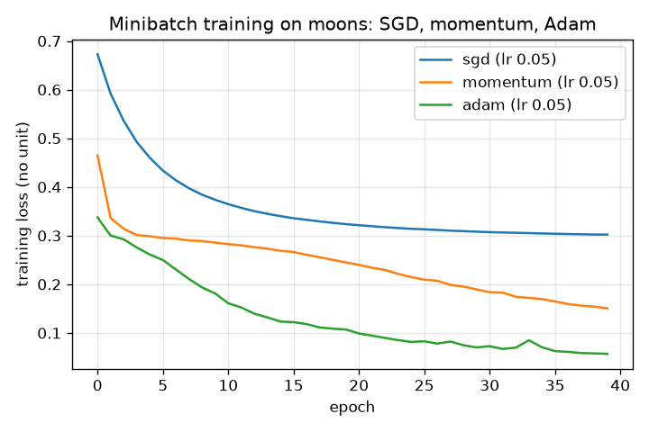
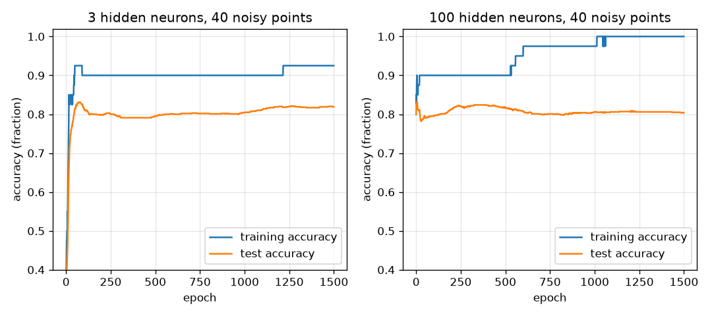
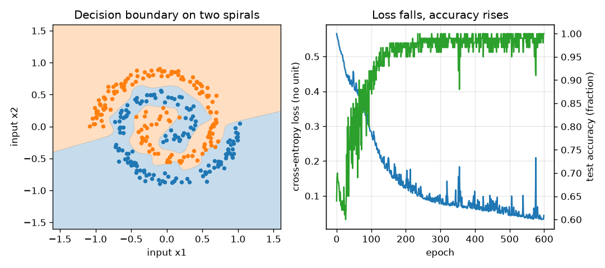
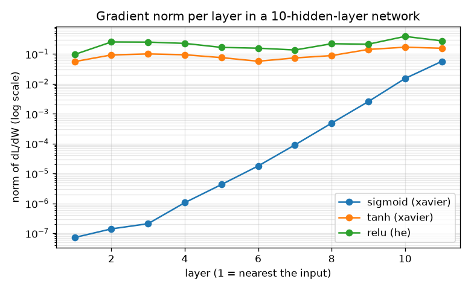

# Session 3: Backpropagation: train a two-layer network

*Level 3 (simulation and validation) · about 90 minutes · openneuralnet*

> This is a simplified educational model. It is not a validated design tool and must not be used for real structures, electrical installations, vehicles, industrial processes or medical decisions.

**Prerequisites**

- Session 2: the sigmoid, cross-entropy and gradient descent.
- The chain rule for derivatives; Section B re-derives what you need.

**Learning objectives.** After this session you can:

- Derive and code the forward pass and backpropagation (dL/dW2 and dL/dW1) of a two-layer network in numpy.
- Verify every gradient against finite differences with a relative error below 1e-6.
- Train on XOR and a seeded spiral data set to high test accuracy, and write minibatch SGD with momentum and Adam.
- Measure overfitting, the effect of initialisation, a learning rate that is too high and vanishing gradients.

## A. Real-world problem
A single neuron draws one straight line, so it cannot solve XOR or separate two interleaved spirals. Stack neurons in two layers and the decision curve can bend around the spirals. But the network has hundreds of weights: how do we get the slope of the loss for every one of them, cheaply and correctly? Backpropagation is the chain rule from calculus arranged to reuse work, and the finite-difference gradient check tells us whether we wrote it correctly. This is general education about neural networks, not a tool for real decisions.

## B. Concept and theory
Take N examples X (N rows, 2 columns) with labels y. Layer 1: Z1 = X W1 + b1, hidden activations H = phi(Z1) with phi = tanh (slope 1 - tanh^2). Layer 2: Z2 = H W2 + b2, output P = sigmoid(Z2). Loss L = -mean(y ln P + (1 - y) ln(1 - P)). Backpropagation applies the chain rule from the output backwards. At the output, the sigmoid and the cross-entropy combine (Session 2) into dZ2 = (P - y) / N. Then dL/dW2 = H^T dZ2 and dL/db2 = the column sum of dZ2. Pass the error back: dH = dZ2 W2^T, and through the hidden bend dZ1 = dH * phi'(Z1) (elementwise product). Then dL/dW1 = X^T dZ1 and dL/db1 = the column sum of dZ1. Gradient check: for each weight w, (L(w + h) - L(w - h)) / (2h) must match the backprop value; we report the largest relative error |a - n| / max(|a| + |n|, 1e-12). Optimisers: SGD w = w - lr g; momentum v = beta v + g, w = w - lr v; Adam keeps running averages m and v of g and g^2, with bias correction, and steps lr * m_hat / (sqrt(v_hat) + eps). Failure modes: all-zero weights keep every hidden neuron identical (no symmetry breaking); a learning rate that is too high makes the loss explode; a deep sigmoid network multiplies slopes of at most 0.25 layer after layer, so the gradient at the first layers vanishes; with many hidden neurons and few noisy points the network memorises (training accuracy 1.00, test accuracy much lower).

| Symbol | Meaning | Unit |
|---|---|---|
| X, y | inputs (N rows, 2 columns) and labels (0 or 1) | no unit |
| W1, b1, W2, b2 | weights and biases of layer 1 (2 by h, h) and layer 2 (h by 1, 1) | no unit |
| H | hidden activations phi(X W1 + b1) | no unit |
| P | output probability sigmoid(H W2 + b2) | no unit |
| dZ2, dZ1 | gradient of the loss with respect to the pre-activations of layer 2 and 1 | no unit |
| lr, beta, b1, b2 | learning rate, momentum factor (0.9), Adam averaging factors (0.9 and 0.999) | no unit |
| h | number of hidden neurons | count |

**Assumptions**

- Binary classification with a sigmoid output and the cross-entropy loss.
- Hidden activation tanh (or ReLU or sigmoid in the experiments); weights start random (scale sqrt(1 / fan_in), He scale for ReLU) unless stated.
- Toy data in 2D generated by code with a seed; accuracy numbers are for those data sets, not for real images or text.
- The gradient check uses a step h = 1e-5 and the central difference, whose error is of order h^2.

$$ Z_1 = XW_1 + b_1,\quad H = \tanh Z_1,\quad Z_2 = HW_2 + b_2,\quad P = \sigma(Z_2) $$

$$ L = -\frac1N\sum_i\bigl[y_i\ln P_i + (1-y_i)\ln(1-P_i)\bigr] $$

$$ dZ_2 = \frac{P - y}{N},\qquad \frac{\partial L}{\partial W_2} = H^{\mathsf T} dZ_2,\qquad \frac{\partial L}{\partial b_2} = \sum_i (dZ_2)_i $$

$$ dZ_1 = \bigl(dZ_2\,W_2^{\mathsf T}\bigr)\odot\bigl(1-H^2\bigr),\qquad \frac{\partial L}{\partial W_1} = X^{\mathsf T} dZ_1,\qquad \frac{\partial L}{\partial b_1} = \sum_i (dZ_1)_i $$

$$ \text{rel. error}=\frac{|a-n|}{\max(|a|+|n|,\,10^{-12})},\qquad n=\frac{L(w+h)-L(w-h)}{2h} $$

$$ m\leftarrow \beta_1 m+(1-\beta_1)g,\;\; v\leftarrow \beta_2 v+(1-\beta_2)g^2,\;\; w\leftarrow w-\text{lr}\,\frac{m/(1-\beta_1^t)}{\sqrt{v/(1-\beta_2^t)}+\epsilon} $$

## C. Visual explanation
The decision-boundary figure shows the network's answer over the plane for two spiral arms: orange and blue regions follow the arms, and next to it the loss falls while the test accuracy reaches 1.00. The optimiser figure compares plain SGD, momentum and Adam on the same moons data: after 40 epochs the losses are about 0.30, 0.15 and 0.06. The overfitting figure shows a network with 100 hidden neurons reaching training accuracy 1.00 on 40 noisy points while the test accuracy stays near 0.80. The last figure plots the gradient norm layer by layer in a 10-layer network on a log scale: the sigmoid curve falls from about 6e-2 at the output to 7e-8 at the first layer, while tanh and ReLU stay within a factor of three.

*Minibatch training on moons: SGD, momentum and Adam, loss against epoch.*

*Training and test accuracy for 3 and 100 hidden neurons on 40 noisy points.*

*Two spirals: the learned decision boundary (left) and the loss with the test accuracy (right).*

*Gradient norm in each layer of a 10-hidden-layer network (log scale): sigmoid vanishes, tanh and ReLU do not.*

## D. Interactive simulation
Run the lesson (`python start.py 3`), then open the live app: [Session 3: train a network on XOR](https://krunalpanchal1995.github.io/openneuralnet/session-03/) (or `app.html` in this folder). Train a tiny network on the four XOR points. Change the number of hidden neurons, the learning rate and the number of epochs, and compare the map of the network's answer with the loss curve. Try one hidden neuron.

**Challenge.** Get all four XOR points right in at most 600 epochs.

## E. Worked example and experiment
**Problem.** A 2-2-1 tanh network has W1 = [[0.5, -0.3], [0.2, 0.4]], b1 = (0, 0), W2 = (0.6, -0.4)^T, b2 = 0. For the one example x = (1, 0) with label y = 1 compute the forward pass, the loss and the gradients dL/dW2 and dL/dW1 by hand.

1. Layer 1: Z1 = x W1 = (0.5, -0.3). H = tanh Z1 = (0.4621, -0.2913).
2. Layer 2: Z2 = 0.6*0.4621 + (-0.4)*(-0.2913) = 0.3938, P = sigmoid(0.3938) = 0.5972, loss = -ln 0.5972 = 0.5155.
3. Output error (N = 1): dZ2 = P - y = -0.4028. So dL/dW2 = H^T dZ2 = (-0.1861, 0.1173).
4. Pass back: dH = dZ2 W2^T = (-0.2417, 0.1611). The tanh slopes are 1 - H^2 = (0.7865, 0.9151), so dZ1 = (-0.1901, 0.1474).
5. dL/dW1 = x^T dZ1: the first row is (-0.1901, 0.1474) and the second row is 0 because x2 = 0. The gradient check on this network gives a relative error of about 1e-11, well below 1e-6.

**Answer.** P = 0.5972, loss 0.5155, dL/dW2 = (-0.1861, 0.1173), dL/dW1 = [[-0.1901, 0.1474], [0, 0]]; the numbers match the code and a finite-difference check.

**Experiment.** Check the same gradient with a calculator: change W1[0][0] from 0.5 to 0.5001, recompute the loss and divide the change by 0.0001; you should get about -0.1901. Real networks differ from this toy in size (millions of weights), in the data (images, text) and in training noise, and a model that scores well on a toy set can fail on real data. Always keep test points the network never trained on.

## Real-world application and mini-project: Classify a synthetic two-class data set and report the confusion matrix
A lab gives you 400 points of the two-moons data set with noise 0.25 (`make_moons(400, 0.25, 11)`). Split it 75 percent training and 25 percent test with `split(X, y, 0.25, 0)`. Train a network with `init_params([2, h, 1], 0)`, Adam, learning rate 0.02, batch size 32 and 300 epochs for h = 2, 4 and 16 hidden neurons. The test accuracy must reach at least 0.92. This is general education about classification, not a decision tool.

**Deliverable:** A script that prints the test accuracy for h = 2, 4 and 16, names the smallest h that reaches 0.92, prints the 2 by 2 confusion matrix for h = 16 (rows true class, columns predicted class), and saves a decision-boundary picture with the test points.

**Success looks like:** h = 2 fails (test accuracy 0.83), h = 4 passes (0.96), h = 16 gives 0.97 with the confusion matrix [[50, 2], [1, 47]] on the 100 test points.

## F. Assessment and design challenge
**Question type A: Conceptual.** Why does the gradient check use two-sided differences and a relative error, and what does it tell you if the error is 1e-2 instead of 1e-9?

Hint

Think about the size of the error of (L(w + h) - L(w)) / h versus the two-sided version, and about gradients of very different sizes.

Step-by-step solution

The two-sided difference (L(w + h) - L(w - h)) / (2h) has error of order h^2, the one-sided has error of order h, so it is far more accurate. A relative error compares the size of the mismatch with the size of the gradient, so tiny gradients and big gradients are judged fairly. A relative error near 1e-9 means backprop and the numbers agree; 1e-2 means a real bug (the checkpoint shows that forgetting the tanh slope gives about 0.5).

**Question type B: Numerical.** An output neuron gives P = 0.8 for a point with label 1 and the hidden activations are H = (0.5, -0.5), with N = 1. Find dZ2, dL/dW2 and the loss.

Hint

dZ2 = P - y, dL/dW2 = H times dZ2, loss = -ln P for label 1.

Step-by-step solution

dZ2 = 0.8 - 1 = -0.2. dL/dW2 = -0.2 * (0.5, -0.5) = (-0.1, 0.1). Loss = -ln 0.8 = 0.2231. Gradient descent adds to W2 a step against the gradient: W2[0] grows and W2[1] falls, which makes the output larger for this point. All values are dimensionless.

**Question type C: Graph and simulation interpretation.** In the gradient-norm figure, what is the ratio of the first-layer to the last-layer gradient norm for a 10-layer sigmoid network, and for tanh and ReLU? What does it say about training the first layers?

Hint

Read the two ends of each curve; the vertical axis is logarithmic.

Step-by-step solution

For sigmoid the first layer has a gradient about 1.3e-6 times that of the last layer (7e-8 versus 6e-2): the early layers barely learn, the vanishing gradient. For tanh the ratio is about 0.36 and for ReLU about 0.35: the early layers still receive a usable gradient (with these initialisations: scale sqrt(1 / fan_in) for tanh, sqrt(2 / fan_in) for ReLU). At 20 sigmoid layers the ratio is about 2e-13.

**Question type D: Design and optimisation challenge.** Design (mini-project): on the two-moons data (400 points, noise 0.25, seed 11, 25 percent test) choose the smallest number of hidden neurons among 2, 4, 16 that reaches 0.92 test accuracy, and say what is lost by making the network larger than needed.

Hint

Train h = 2, 4 and 16 with Adam, lr 0.02, batch 32, 300 epochs and compare the test accuracy and the train-test gap.

Step-by-step solution

h = 2 reaches only 0.83 (too little capacity: two hidden neurons cannot bend the boundary enough), h = 4 reaches 0.96 and h = 16 reaches 0.97. The smallest h that passes is 4. A bigger network costs more computation and, on few noisy points, more risk of memorising (Session 3 overfitting experiment: 100 hidden neurons give training accuracy 1.00 and test accuracy 0.80 on 40 points). Assumption: one fixed seed, so a different split could change the third digit.

Score yourself with [RUBRIC.md](../../RUBRIC.md). Print the [activity sheet](activity_sheet.md) to work on paper.

## Common misconceptions
| Common misconception | What is actually true |
|---|---|
| Backpropagation is a different learning method from gradient descent. | Backpropagation only computes the gradient (efficiently, with the chain rule). The weight update is still gradient descent, SGD, momentum or Adam. |
| If the loss goes down, the gradients must be right. | A wrong gradient can still reduce the loss slowly or by luck. Only the finite-difference check tells you the gradients are correct. |
| Start all weights at zero, it is the neutral choice. | With zero weights every hidden neuron gets the same gradient and stays identical (symmetry), and with tanh nothing is learned at all; the loss stays at ln 2 = 0.693. |
| Training accuracy 1.00 means the model is good. | Memorising noise gives training accuracy 1.00 and a much lower test accuracy. Always report accuracy on points that were not used for training. |
| Deeper is always better. | In a deep sigmoid network the gradient at the first layers vanishes (about 1e-6 of the last layer at 10 layers), so very deep networks need better activations, initialisation or architecture. |

## Glossary
- **backpropagation**: computing the gradient of the loss for every weight by applying the chain rule from the output backwards
- **chain rule**: the derivative of a composition is the product of the derivatives of its steps
- **hidden layer**: a layer of neurons between the input and the output
- **activation function**: the bend applied to a neuron's weighted sum, for example tanh, ReLU or sigmoid
- **minibatch**: a small random subset of the training examples used for one update
- **momentum**: an optimiser that keeps a running average of past gradients
- **Adam**: an optimiser that scales each step by running averages of the gradient and its square
- **overfitting**: fitting the noise of the training points so that test accuracy is much lower than training accuracy
- **vanishing gradient**: a gradient that shrinks towards 0 layer after layer, so early layers do not learn
- **confusion matrix**: a table counting, for each true class, how many points were predicted as each class

## Finish
1. Do the three coding tasks in [exercises.md](exercises.md).
2. Run `python start.py 3` again after your changes. It ends with the checkpoint; when it prints `PASS`, you are done. (Checkpoint only: `python start.py check 3`.)

Next: the [roadmap](../../promo/roadmap.md). Session 4 is yours to build.
